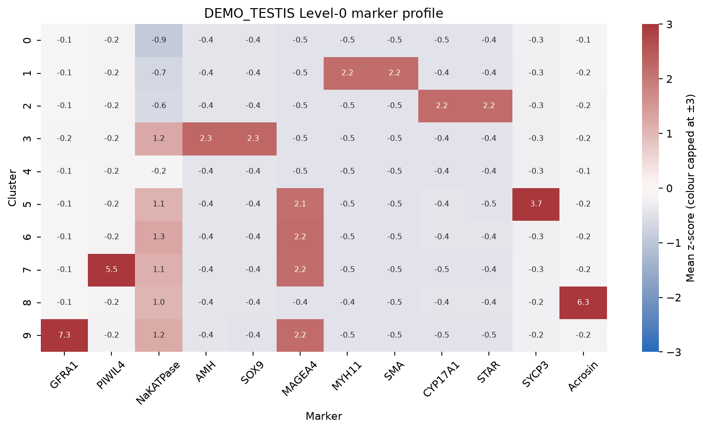
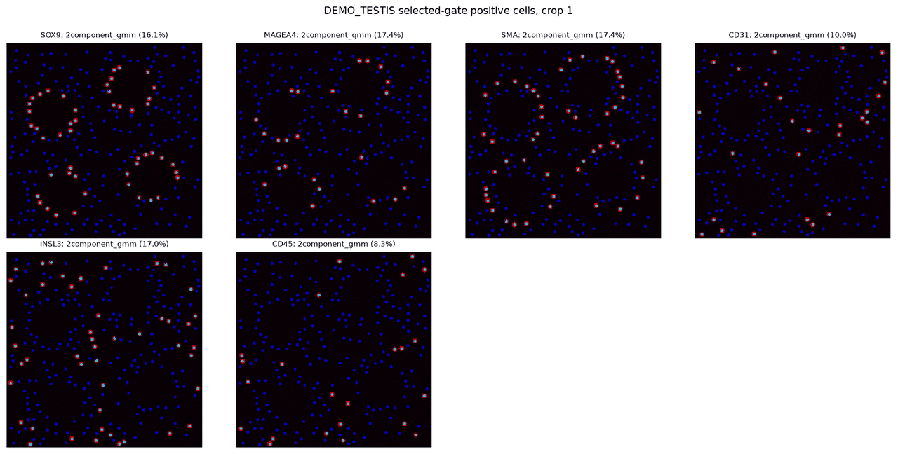
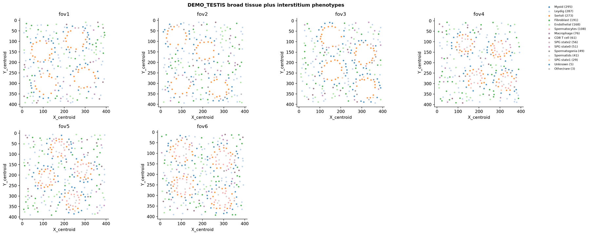
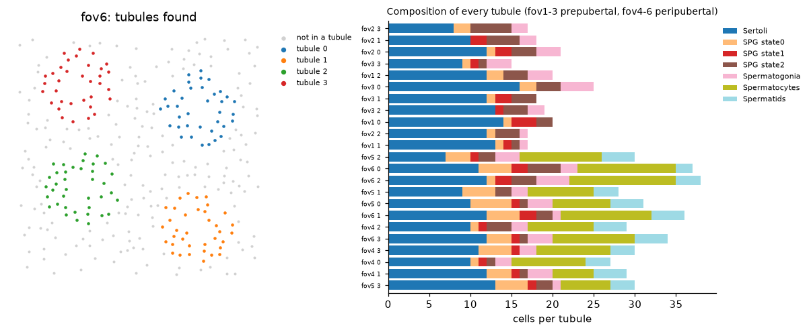
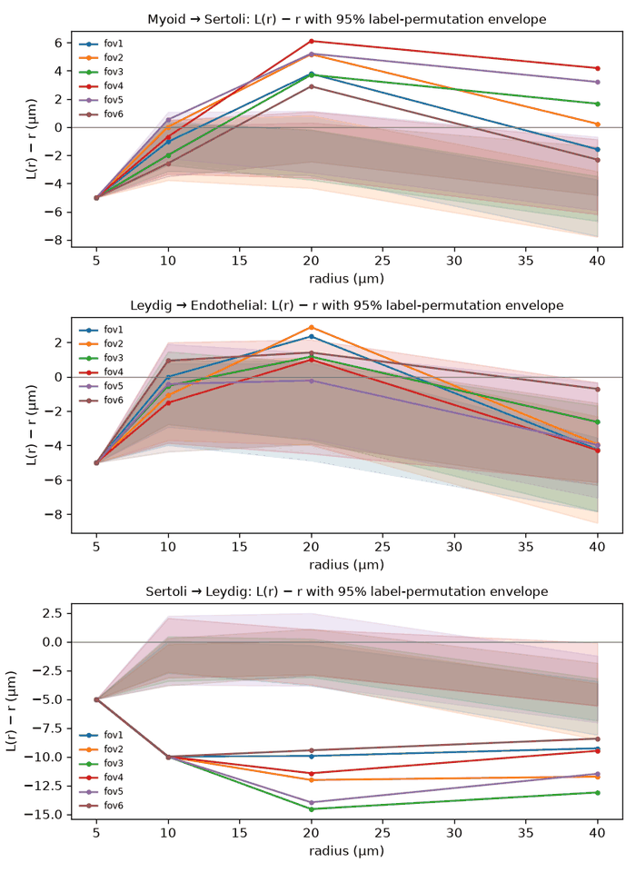

# 5b. Cell types by clustering and gating

This is the alternative to [step 5](qupath.md): cell types are assigned inside
SpatioEv, without QuPath. It suits a multi-FOV TMA that went through ARK
segmentation, when you know which markers define each cell type.

**What it does:** builds one AnnData file from the ARK cell tables, with its
columns in the same order as the image channels. It then works in three
layers:

1. **Clustering** finds the tissue structures (in testis: tubule,
   peritubular myoid, interstitium).
2. **Gating** decides, for every marker, which cells are positive.
3. **Prior-knowledge rules** (scimap style) combine the two: inside each
   structure, a cell's positive markers decide its cell type.

The result feeds the spatial analysis: individual tubules, what each tubule
contains, and co-localisation.

**What it needs:**

- the ARK cell tables (`cell_table_arcsinh_transformed.csv` and
  `cell_table_size_normalized.csv`);
- the marker list `background/markers_bs.csv`;
- one image per FOV;
- a table of rules saying which markers define each cell type.

**How long:** about 30 minutes on the demo data. With your own data, allow an
afternoon for the first FOVs, mostly for checking gates.

```text
 ARK cell tables + markers_bs.csv + FOV images
        │
        ├─ 00 Prepare AnnData      one file; columns in image-channel order
        ├─ 01 Broad clustering     Tubule / Myoid / Interstitium   (structures)
        ├─ 02 Marker gating        a positive / negative cut-off per marker
        ├─ 03 Subset phenotyping   rules inside each structure → cell types
        └─ F. Spatial analysis     tubules, their composition, co-localisation
```

## The folder layout it expects

```text
ST_TMA_01/                                  ← project root (one TMA)
├── background/markers_bs.csv               ← the marker of every image plane, in image order
├── dearray/1.ome.tif … N.ome.tif           ← one image per FOV (1.ome.tif is fov1)
├── ark_wdir_1/segmentation/
│   ├── cell_table/cell_table_arcsinh_transformed.csv   → becomes adata.X
│   ├── cell_table/cell_table_size_normalized.csv       → becomes the layer "size_normalized"
│   └── deepcell_output/fov1_whole_cell.tiff …          ← cell masks
├── ark_wdir_2/ …                           ← further ARK runs, each with some of the FOVs
└── data/                                   ← SpatioEv writes the AnnData here
```

!!! warning "markers_bs.csv decides which marker each column is"
    The image planes usually carry no marker names (at most `C0`, `C1`, …),
    and ARK writes the cell-table columns in **alphabetical** order. The only
    record of which marker sits in
    which image plane is the **row order** of `markers_bs.csv`: row 1 is
    plane 0, row 2 is plane 1, and so on. SpatioEv puts the AnnData columns
    (`adata.X`) in exactly that order, so column *n* of `adata.X` is image
    plane *n*.

    - Do not sort the file. Its `channel_number` column restarts at 1 in every
      imaging cycle, so sorting by it mixes the cycles up.
    - To leave a plane out of the analysis (an empty or failed channel), keep
      its row and add a column `remove` with `TRUE` in that row. The plane
      stays in the image, but it is not used as a marker.

!!! note "AnnData files made with SpatioEv 0.2.0 or earlier must be rebuilt"
    Those versions sorted `markers_bs.csv` by `channel_number`, which paired
    most markers with the wrong image plane. Pages 01 and 02 recognise such
    files and show a warning. Rebuild the file with page 00 (section B) and
    redo anything made from it.

## A. Create the demo data

The demo is a small **synthetic** testis TMA: six FOVs of made-up tissue in
exactly the layout above, with a 30-marker cyclic-IF panel. FOVs 1–3 are
"prepubertal" (tubules with Sertoli cells and spermatogonia only); FOVs 4–6
are "peripubertal" (also spermatocytes and spermatids). It contains no
patient data.

In Terminal:

```bash
conda activate spatioev_env
```

```bash
spatioev demo ~/SpatioEv_practice --kind testis
```

It takes a few seconds and creates `~/SpatioEv_practice/DEMO_TESTIS`. Besides
the folders above, it holds:

| File | What it is |
|---|---|
| `tubule_phenotype_workflow.csv`, `interstitium_phenotype_workflow.csv` | the cell-type rules for section E |
| `manual_gates.csv` | hand-set gates for some FOVs, in the per-FOV layout (section E) |
| `data/DEMO_TESTIS_marker_condition_for_gating.csv` | answers to the staining questionnaire of section D |
| `fov_metadata.csv` | the age group of each FOV |
| `ground_truth.csv` | the true cell type of every cell, to check the result (section G) |

Open the app on it:

```bash
spatioev ui --project-root ~/SpatioEv_practice/DEMO_TESTIS
```

On the home page, type `DEMO_TESTIS` as the **Sample ID** and press **Apply**.
Every page below then fills in its paths for you.

!!! tip "Start again at any time"
    `spatioev demo ~/SpatioEv_practice --kind testis --overwrite` replaces the
    whole `DEMO_TESTIS` folder, **including** everything you made in it.

## B. Prepare AnnData (page 00)

Open **prepare anndata** in the sidebar. For a TMA folder, **Dataset layout**
is already set to **Multi-FOV / TMA**, and the boxes are filled in from the
project root:

| Box | Demo value | Notes |
|---|---|---|
| **TMA project folder** | `…/DEMO_TESTIS` | the folder that holds `ark_wdir_*` |
| **FOV OME-TIFF folder** | `…/DEMO_TESTIS/dearray` | |
| **Marker order CSV (blank = find automatically)** | leave blank | finds `background/markers_bs.csv` |
| **Dataset ID** | `DEMO_TESTIS` | |
| **Output H5AD** | `…/data/DEMO_TESTIS_adata.h5ad` | |
| **Secondary layer name** | `size_normalized` | |
| **Table assignment** (folded) | `cell_table_arcsinh_transformed.csv` → adata.X, `cell_table_size_normalized.csv` → layer | the defaults; leave them |

1. Press **Inspect TMA**. The **TMA input check** shows three tabs:
    - **ARK batches**: each `ark_wdir_*` folder and its FOVs.
    - **FOV images**: each image and the number of planes it has.
    - **Marker order**: one row per image plane, with the marker it holds and
      whether it goes into `adata.X`.

    A blue note above the tabs names the marker CSV it found. Check that the
    first rows of **Marker order** match the first rows of your
    `markers_bs.csv`.
2. Press **Build TMA AnnData**. It takes seconds for the demo and a few
   minutes for a large TMA.

You get `data/DEMO_TESTIS_adata.h5ad`, with:

- `adata.X`: arcsinh values, columns in `markers_bs.csv` order;
- the layer `size_normalized`;
- `imageid` (the FOV, `fov1` …), `label` and `X_centroid`/`Y_centroid` for
  each cell.

`data/DEMO_TESTIS_adata_qc/` holds the checks:

- `marker_channel_order.csv`: the plane-by-plane order that was used;
- `cells_per_fov.csv`;
- a marker-distribution plot and a centroid-coverage plot.

!!! note "Only some FOVs have an image?"
    That is fine. A TMA's images are large, so often only a few are copied
    locally. Every FOV is converted from its cell table; a warning lists the
    FOVs without an image. Image review and overlays on the next pages offer
    only the FOVs that have one. Image file names must contain the FOV
    number (`22.ome.tif` or `fov22.ome.tif`).

!!! warning "If Inspect TMA says *Marker order CSV lists … markers but 1.ome.tif has … image channels*"
    The marker CSV has a different number of rows than the images have
    planes. Usually the wrong CSV was found (for example an older copy in a
    parent folder). Type the path of the right one into **Marker order CSV**.

## C. Find the tissue structures (page 01)

Open **broad clustering**. The paths are filled in from the sample ID.

1. Press **Load sample**. Keep **Clustering scope** at **All FOVs jointly**,
   so a cluster means the same thing in every FOV.
2. In **2. Level-0 clustering**, keep the **Testis structures** marker
   preset. It is chosen automatically when the panel holds the testis markers,
   and selects the markers that separate the structures, not the cell
   subtypes:

    `GFRA1, PIWIL4, NaKATPase, AMH, SOX9, MAGEA4, MYH11, SMA, CYP17A1, STAR`

    They were picked from the images of a 28-core testis TMA. GFRA1, PIWIL4,
    NaKATPase and AMH stain only inside tubules in every core; SOX9 marks
    Sertoli cells and MAGEA4 spermatogonia. SMA and MYH11 mark the smooth
    muscle of the peritubular wall, and CYP17A1 and STAR mark Leydig cells.
    DMRT1 is left out because it stains Sertoli and germ cells alike. Broad
    stains such as Vimentin, NF2F2, CD45 or CD68 are left out because on real
    tissue they stain cells in every structure and blur the clusters.

    **For the demo, add `SYCP3` and `Acrosin` to the markers.** Its older FOVs
    hold spermatocytes (SYCP3) and spermatids (Acrosin). The preset leaves
    them out because a testis before puberty has no meiotic cells, and the
    two channels then add only noise. Add them for any pubertal or adult
    testis: without them, 19 of the demo's 41 spermatids end up *Unknown*.

    Set **Leiden resolution** to `0.6` and **Neighbors** to `15`. Keep
    **Z-score markers** ticked. Leave **Z-score within each FOV** and
    **Average markers over neighbouring cells** unticked for the demo (see
    the tips below for real TMAs).
3. Press **Run Level-0 clustering**. The heatmap shows each cluster's marker
   profile:

    { width="900" }

    Clusters with Sertoli markers (SOX9, AMH), germ-cell markers (MAGEA4,
    GFRA1, PIWIL4, SYCP3, Acrosin) or NaKATPase are **inside tubules**.
    SMA/MYH11 marks the **peritubular myoid** ring. CYP17A1/STAR marks Leydig
    cells. Clusters with none of these markers are the other interstitial
    cells (vessels, immune cells, fibroblasts). Leydig and these clusters
    make up the **interstitium**. **Launch Level-0 napari review** shows the
    clusters on the image if a cluster is unclear.
4. In **3. Assign broad cluster labels**, choose `Tubule`, `Myoid` or
   `Interstitium` in **Annotation** for every cluster. Press **Save Level-0
   annotations**.
5. Skip **4. Optional cluster refinement** for the demo: its structures
   separate cleanly at Level-0. For real tissue, see the tip *Real testis
   TMAs* below. Then press **Export broad phenotyping** in **5. Merge and
   export**.

The result is `results/DEMO_TESTIS_clustering_workflow/DEMO_TESTIS_phenotyped.h5ad`.
It holds every marker and the column `annotation` (Tubule / Myoid /
Interstitium), and the next two pages use it.

!!! tip "Clusters made of one or two FOVs"
    Real cores differ in staining and imaging. If the summary table or the
    heatmap shows clusters that come mostly from one or two FOVs, run again
    with **Z-score within each FOV** ticked: each marker is then scaled
    separately in every FOV. Check the result on a FOV's image (**Launch
    Level-0 napari review**): tubule labels should fill the tubules and myoid
    labels sit on the SMA rings. It suits TMAs where every core holds several
    structures; a core that is almost all one structure gets scaled to look
    like the others.

!!! tip "Name clusters on several FOVs"
    On a real TMA, a cluster can look like tubule in one core and like wall in
    another. A wrong name moves every cell of the cluster, so this matters
    more than the exact settings. Before saving, check each cluster's name on
    two or three FOVs: choose them in **FOV selected for clustering or image
    review** and press **Launch Level-0 napari review**.

!!! tip "Real testis TMAs: name two structures first, then refine"
    On a real 28-core TMA (donors 8–14 years old), naming myoid and Leydig
    clusters straight from Level-0 failed. 43% of the hand-gated myoid cells
    sat in clusters that looked like Leydig cells, and whole tubules with
    dimmer staining fell into clusters with no marker. Two steps worked better:

    1. In **3. Assign broad cluster labels**, name each cluster `Tubule` or
       `Interstitium`: whichever group is higher on the heatmap, the tubule
       markers or the wall and Leydig markers. Name a cluster that is low in
       every marker `artifact` (empty or out-of-focus areas). This matched
       hand gates for 86% of cells.
    2. In **4. Optional cluster refinement**, choose `Interstitium` and
       `Tubule`. Their markers are filled in for a testis panel:
        - **Interstitium**: SMA, MYH11, CYP17A1, STAR, CYP11A1, CD68. Name
          the clusters `Myoid` (SMA and MYH11 high), `Leydig` (CYP17A1, STAR
          or CYP11A1 high) or `Other interstitium` (none of them). Leydig and
          myoid cells fell into separate clusters, but check the names on
          several FOVs: in weakly stained cores, many cells named Myoid or
          Leydig were neither.
        - **Tubule**: SOX9, MAGEA4, GFRA1, PIWIL4, AMH, DMRT1, with **Remove
          each cell's overall brightness** ticked. Name the clusters `Sertoli`
          (SOX9 stands out) or `Spermatogonia` (MAGEA4 stands out). The two
          are distinct on the image, but packed cells share some signal, so
          the clusters either miss spermatogonia or include Sertoli cells. A
          MAGEA4 gate (sections D and E) is more precise.

    A small cluster with one marker far below the rest (around −7 on the
    heatmap) holds cells with an empty channel: name it `artifact`. Heatmap
    colours stop at ±3 so such clusters do not wash out the others; every
    cell shows the exact mean.

    `Spermatocyte` and `Spermatid` need SYCP3- or Acrosin-bright cells, which
    a testis before puberty does not have. Folds, where the tissue lies
    double, look like bright tubule and are not separated by clustering.

!!! tip "Clusters that are high in every marker"
    Big, bright or tightly packed cells raise every marker together. On the
    real TMA this shared brightness was 42% of the variation across the
    preset's markers, which gives clusters that are high in everything and
    hard to name. **Remove each cell's overall brightness** (in each
    refinement) subtracts each cell's mean over the refinement markers after
    z-scoring, so the clusters follow which markers stand out instead. It
    helped split Sertoli cells from spermatogonia and made little difference to
    the interstitium.

!!! tip "Interstitial cells end up in tubule or myoid clusters"
    Most interstitial cells carry none of the preset's markers, so per cell
    they can join any cluster of cells low in every marker. **Average markers
    over neighbouring cells** gives each cell the mean of the cells around it
    (15 µm suits testis cores), so the clusters follow the tissue instead.
    Type your scan's pixel size; it is not read from the image. SMA and MYH11
    stay per cell, so the wall, one cell thick, is not blurred. On a 28-core
    testis TMA it improved some cores and not others, so run both ways and
    compare them on several FOVs before choosing.

!!! note "Why cluster first, and only for structures?"
    Structures are large and distinct, so clustering finds them reliably.
    Clustering is poor at small subtypes (four spermatogonia states, rare
    T cells). Those are better defined by explicit marker rules (section E),
    applied only inside the right structure. A rule like "MAGEA4+ means germ
    cell" is then only ever applied to tubule cells.

## D. Gate the markers (page 02)

A **gate** is the cut-off above which a cell counts as positive for a
marker. Open **marker autogating**.

1. Check the boxes: **AnnData (.h5ad)** points at step C's
   `DEMO_TESTIS_phenotyped.h5ad`, and **OME-TIFF image or FOV image folder**
   at `dearray`.
2. Type `size_normalized` in **Expression layer**, then press **Load sample**.

    !!! warning "Use the layer your gates are meant for"
        Gates are set on log1p of the chosen expression values. Size-normalised
        intensities (ARK's mean intensity per cell) are the usual choice for
        gating and the scale most hand-made gate tables use. Step E must use
        the same layer. Page 02 records it, and page 03 fills it in.

3. **2. Marker staining questionnaire (optional).** The demo's answers load
   automatically from `data/DEMO_TESTIS_marker_condition_for_gating.csv`
   (a blue note names the file). For your own data, at least answer:
    - **Staining condition**: `clear_specific` for a clean stain;
    - **Artifact level**: `low` for little background;
    - **Compartment**.

    Answer them for every marker your rules use. Answers are saved with the
    gates and loaded again next time.

    !!! warning "Unanswered markers get cautious gates"
        Without answers, a marker gets an upper-tail gate that only calls its
        brightest cells positive. That is safe for rare markers. For broadly
        expressed ones it misses most positive cells. In the demo, leaving the
        questionnaire blank set the `Vimentin_2` and `NF2F2` gates so high that most
        fibroblasts ended up *Unknown*. With the answers, 99.3% of cells got
        their correct type.

4. Press **Calculate gates** (**3. Calculate initial gates**). The table lists
   each marker's gate, the method chosen and the fraction of positive cells.
   The histograms in `qc/` show each gate on its distribution. A
   `3GMM_high_is_majority` flag means the usual gate would have called most
   cells positive, so a stricter one was used. Check those markers on the
   image in the next step.
5. **4. Gate QC → Generate spatial QC images** marks the positive cells on the
   image of the FOV chosen under *FOV used for image QC and gate review*:

    { width="900" }

    Positive cells (red circles) should sit where the stain is: SOX9 on the
    tubule edge, SMA on the ring around each tubule, CD31 on vessels.
6. To adjust a gate by eye, press **Launch napari gate review** (**5. Review
   on the original image**). It opens a viewer with a slider per marker.
   Slider positions are saved as you go. Press **Export reviewed gates** in
   the viewer when you are done.

The gates are in `results/DEMO_TESTIS_marker_gating_qc/DEMO_TESTIS_scimap_manual_gates.csv`.
Calculating again, or exporting from the viewer, replaces this file. The
version before it is kept in `details/` as
`DEMO_TESTIS_scimap_manual_gates_previous.csv`.

### Gate tables you made yourself

Page 03 also accepts a gate table you set by hand (in napari, QuPath or
elsewhere). It can have one gate per marker for all FOVs:

```text
markers,gates
SOX9,5.6
MAGEA4,5.9
```

or one column per FOV, when staining differs between FOVs:

```text
markers,fov5,fov13,fov23
SOX9,5.6,5.7,5.3
MAGEA4,5.9,6.1,5.5
```

Values are **log1p** of the gate layer. The column names must be the FOV
names in `adata.obs["imageid"]` (`fov1`, `fov2`, …). The demo's
`manual_gates.csv` uses the per-FOV layout and, like a table still being
made, covers only fov1, fov3 and fov5.

## E. Assign cell types with rules (page 03)

### The rules file

A **phenotype workflow** CSV lists every cell type, its parent, and the
markers that define it:

```text
parent,phenotype,SOX9,AMH,MAGEA4,SYCP3,Acrosin,UTF1_2,PIWIL4,GFRA1,PCNA,DMRT1,CLDN11_1
all,Sertoli,anypos,anypos,,,,,,,,,anypos
all,Germ cells,,,anypos,anypos,anypos,,,,,,
Germ cells,Spermatogonia,,,allpos,allneg,,,,,,,
Germ cells,Spermatocytes,,,,pos,,,,,,,
Germ cells,Spermatids,,,,,pos,,,,,,
Spermatogonia,SPG state0,,,,,,anypos,anypos,,,,
Spermatogonia,SPG state1,,,,,,,,pos,,,
Spermatogonia,SPG state2,,,,,,,,,anypos,anypos,
```

- `parent` = `all` is a top-level type. Other rows are only tried on cells
  already given their parent (a spermatogonium must first be a germ cell).
- `pos` / `neg`: the marker should be positive / negative.
- `anypos` / `anyneg`: at least one of these markers is positive / negative.
- `allpos` / `allneg`: every one of these markers must be positive /
  negative.
- Marker names that differ only in a suffix are matched: `CLDN11_1` in the
  rules is used for `CLDN11_2` in the data, and the page lists every such
  match. A marker that cannot be matched stops the run with its name.

!!! warning "A single 'pos' or 'neg' is a preference, not a requirement"
    scimap scores every candidate cell type and picks the highest score. A
    lone `pos` or `neg` marker is only averaged into that score, so a cell
    that breaks it can still win. In the demo, `Spermatogonia` written as
    `MAGEA4 pos, SYCP3 neg` swallowed SYCP3+ spermatocytes. Write `allpos` /
    `allneg` when a marker **must** be positive or negative. **Inspect
    inputs** points out rows where this applies.

    With two or more `pos` (or `neg`) markers in a row, a cell that scores
    highest for that type but misses one of them is called
    `likely-<type>`, for example `likely-Fibroblast` for an NF2F2+ cell that
    is Vimentin−. Check these cells on the image, or merge them into the type
    if that is acceptable.

### First run: cell types inside the tubules

Open **subset phenotyping**. The boxes fill in from the sample ID:

| Box | Value |
|---|---|
| **Full-marker H5AD** | step C's `DEMO_TESTIS_phenotyped.h5ad` |
| **Gate CSV** | step D's gates, or the demo's `…/DEMO_TESTIS/manual_gates.csv` |
| **Phenotype workflow CSV** | `…/DEMO_TESTIS/tubule_phenotype_workflow.csv` (type this one in) |
| **Gate layer (blank = adata.X)** | `size_normalized` (filled in from step D) |
| **Images without a gate for a marker** | for `manual_gates.csv`: *Use the marker's median gate of the other images* |
| **Image IDs to phenotype** | leave blank for all FOVs |

**Images without a gate for a marker** says what to do when a per-FOV table
has no gate for a FOV:

- *Stop and list them* (the default) stops and names every missing
  marker/FOV pair.
- *Use the marker's median gate of the other images* uses the median of
  that marker's other FOVs.
- *Estimate with scimap's Gaussian mixture* lets scimap estimate the gate.

To phenotype only the FOVs you have gated, list them in **Image IDs to
phenotype** instead, for example `fov1, fov3, fov5`.

1. Press **Inspect inputs**. Read the blue notes. They list renamed markers,
   filled gates, and rule rows that need `allpos` / `allneg`.
2. Set **Broad annotation column** to `annotation` and **Populations to
   phenotype** to `Tubule`.
3. Type `tubule` in **Subset output name** and `final_phenotype` in
   **Combined final column**.
4. Open **Run settings** and set **Minimum cells per phenotype per image**
   to `0`.

    !!! note "Minimum cells per phenotype per image"
        In each FOV, a cell type with fewer cells than this becomes *Unknown*.
        The default of 10 hides real but small populations in a small TMA
        core. When it relabels cells, the run says how many and which types.

5. Press **Run SCIMAP phenotyping**.

### Second run: cell types in the interstitium

Run the page again on the **result of the first run**, so the two sets of
cell types end up in one column. Change these boxes, press **Inspect inputs**
again, and keep **Minimum cells per phenotype per image** at `0`:

| Box | Value |
|---|---|
| **Full-marker H5AD** | `results/DEMO_TESTIS_scimap_phenotyping_interface/DEMO_TESTIS_broad_plus_tubule_phenotyped.h5ad` |
| **Phenotype workflow CSV** | `…/DEMO_TESTIS/interstitium_phenotype_workflow.csv` |
| **Broad annotation column** | `final_phenotype` |
| **Populations to phenotype** | `Interstitium` |
| **Subset output name** | `interstitium` |
| **Combined final column** | `cell_type` |

Myoid cells need no rules, so they keep their broad label.

`results/DEMO_TESTIS_scimap_phenotyping_interface/DEMO_TESTIS_broad_plus_interstitium_phenotyped.h5ad`
now holds a `cell_type` for every cell:

{ width="900" }

Spermatocytes and spermatids appear only in fov4–6, as built into the demo.
`qc/` holds a marker heatmap per run, image overlays, and
`*_gate_rescale_agreement.csv`, which shows for each marker the fraction of
cells the gate calls positive before and after scimap's rescaling and how
often the two agree (close to 1 is expected).

## F. Spatial analysis

### Individual tubules and what they contain

The app has no page for this yet. Paste the code below into a Jupyter
notebook or a Python file, in the `spatioev_env` environment:

```python
from pathlib import Path

import anndata as ad
import pandas as pd

import spatioev as sv

project = Path("~/SpatioEv_practice/DEMO_TESTIS").expanduser()
sample = "DEMO_TESTIS"
results = project / "results" / f"{sample}_scimap_phenotyping_interface"
adata = ad.read_h5ad(results / f"{sample}_broad_plus_interstitium_phenotyped.h5ad")

# 1. One ID per tubule: tubule cells closer than 35 px (about 17 µm) are joined.
adata = sv.tl.cluster_spatial_components(
    adata, label_key="annotation", label_value="Tubule",
    component_key="tubule_id", radius=35, min_component_size=15,
)
tubules = adata.obs[adata.obs["tubule_id"].str.contains("component")]
print(tubules.groupby("imageid", observed=True)["tubule_id"].nunique())

# 2. What each tubule contains.
composition = pd.crosstab(tubules["tubule_id"], tubules["cell_type"])
composition["imageid"] = tubules.groupby("tubule_id")["imageid"].first()
germ = ["SPG state0", "SPG state1", "SPG state2", "Spermatogonia", "Spermatocytes", "Spermatids"]
composition["germ_cells_per_sertoli"] = composition[germ].sum(axis=1) / composition["Sertoli"]
composition["has_meiotic_cells"] = composition[["Spermatocytes", "Spermatids"]].sum(axis=1) > 0
composition.to_csv(results / f"{sample}_tubule_composition.csv")

# 3. Compare age groups, one value per tubule.
ages = pd.read_csv(project / "fov_metadata.csv").set_index("fov")["age_group"]
composition["age_group"] = composition["imageid"].map(ages)
print(composition.groupby("age_group")[["germ_cells_per_sertoli", "has_meiotic_cells"]].mean().round(2))
```

It finds 23 of the 24 tubules. Peripubertal tubules hold about 2.0 germ
cells per Sertoli cell, and all of them contain meiotic cells; prepubertal
tubules hold about 0.6, and none do.

{ width="900" }

- **`radius`** is in pixels. Pick it a little larger than the gap between
  neighbouring cells of one tubule, but smaller than the gap between two
  tubules.
- **`min_component_size`** drops small fragments, for example a tubule cut by
  the edge of the core.
- For your own data, change `germ` to your germ-cell type names.

!!! note "One value per tubule, then per patient"
    Tubules from one FOV are not independent. For statistics, average the
    tubules of each FOV (or patient) first, and compare those averages, as
    [step 9](cohort.md) does for its standard measures.

### Co-localisation (page 06)

Open **colocalization**. Without a tissue-regions file, **Tissue-regions
AnnData (or any phenotyped AnnData)** fills in with the newest phenotyping
result from section E.

1. Press **Inspect inputs** and set **Phenotype column** to `cell_type`.
2. Add pairs (**Source phenotype** → **Target phenotype**). For the demo:
    - `Myoid → Sertoli`
    - `Leydig → Endothelial`
    - `Sertoli → Leydig`
3. Set **Radii (µm)** to `5, 10, 20, 40` and **Pixel size (µm / px)** to
   `0.5` (the demo's pixel size; use your scanner's).
4. Press **Run co-localisation**.

{ width="700" }

A curve above its shaded band means the target cells sit around the source
cells more than chance. In the demo:

- Myoid cells sit next to Sertoli cells at 20 µm (across the tubule wall).
- Sertoli and Leydig cells avoid each other, because Leydig cells are
  outside the tubules.

[Step 8](colocalisation.md) explains the plots and tables.

## G. Check the demo result against the truth

`ground_truth.csv` holds the true type of every demo cell, so you can see
how close the workflow came. Continuing in the same notebook:

```python
truth = pd.read_csv(project / "ground_truth.csv", keep_default_na=False)
called = adata.obs[["fov", "label", "annotation", "cell_type"]].astype({"label": int})
both = called.merge(truth.rename(columns={"cell_type": "true_type"}), on=["fov", "label"])
print("structures:", (both["annotation"] == both["compartment"]).mean().round(3))
print(pd.crosstab(both["true_type"], both["cell_type"]))
```

With the settings above, every structure label is correct, and about 99% of
cell types are. The truth file names a few types slightly differently
(`Spermatid` for `Spermatids`, `T cell` for `CD8 T cell`). Every
spermatogonium is `Spermatogonia` there, and its state is in the
`spg_state` column:

- state0 = UTF1/PIWIL4 (`SPG state0` in the result);
- state1 = GFRA1 (`SPG state1`);
- state2 = PCNA/DMRT1 (`SPG state2`);
- state3-4 has none of these markers and keeps the parent name
  `Spermatogonia`.

Try the effect of each setting here. For example, write `Spermatogonia` with
`pos`/`neg` instead of `allpos`/`allneg`, or leave the questionnaire blank,
and see which cells change.

## H. Your own TMA

1. Arrange the folder as in [the layout above](#the-folder-layout-it-expects).
   Copy `markers_bs.csv` as it came from background subtraction, unsorted.
2. Start the app with your folder as the project root, for example:

    ```bash
    spatioev ui --project-root /Users/you/Data/ST_TMA_01
    ```

3. Go through sections B–E. Use the same sample ID on every page (the folder
   name, here `ST_TMA_01`).
    - In section C, choose markers that separate the structures you expect.
    - Build the rules from your panel. Start from the demo's two workflow
      files and change the rows and marker columns.
4. If you already have per-FOV gates, give them as the **Gate CSV** in
   section E. Set **Gate layer** to the values they were drawn on
   (`size_normalized` for gates set on log1p of size-normalised intensities).
   Either phenotype only the gated FOVs (**Image IDs to phenotype**) or choose
   how to fill the gaps.

!!! tip "Keep each run's settings"
    Every run writes its settings to `logs/` inside its results folder
    (`*_config.json`), next to its log. To repeat a run later, or to tell
    someone exactly what you did, copy the values from there.

The output files are listed in [Output files explained](outputs.md#cell-types-by-clustering-and-gating-steps-0003).

The later steps find the newest result of page 03 themselves. In
[co-localisation](colocalisation.md) and [tissue regions](regions.md), choose
`cell_type` as the phenotype column where they offer QuPath's classes.

Next: [Matrix fibers](fibers.md) if your panel has matrix channels, otherwise
[Co-localisation](colocalisation.md).
